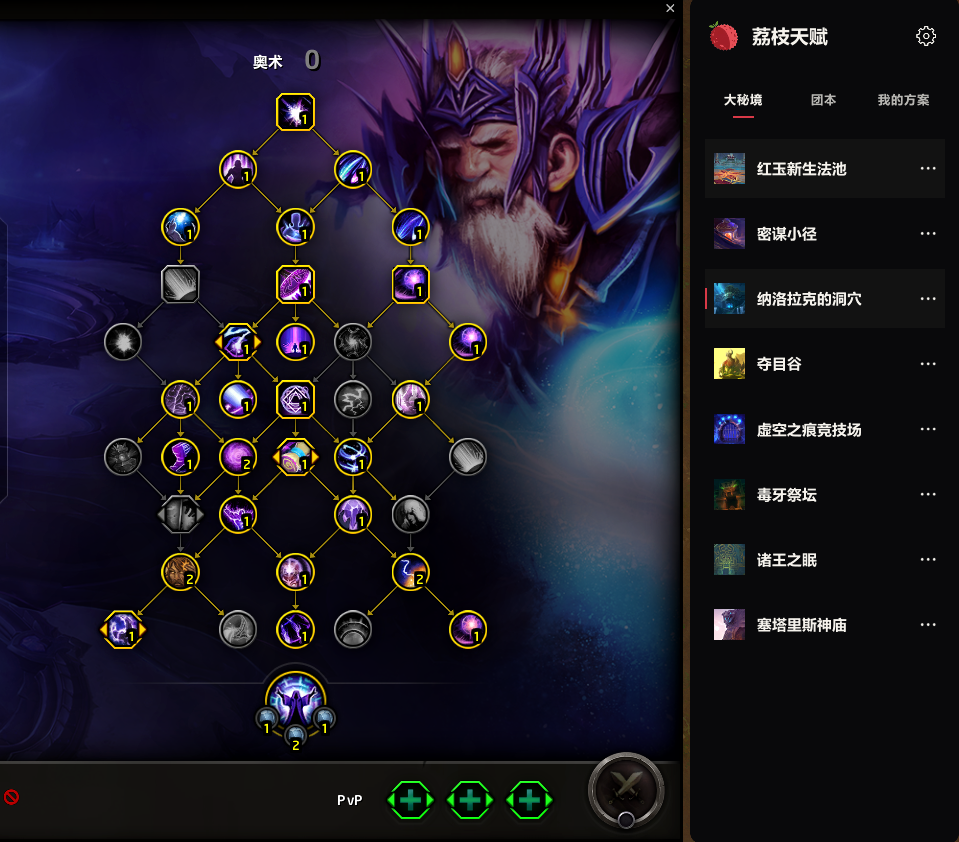

# Lychee Talent

**Find your build for the encounter. Keep your focus on the fight.**

Open talents. Pick the encounter. Double-click to apply.

[简体中文](README.md) · [English](README.en.md)

Browse builds drawn from high-performing WCL records beside the native talent window. Keep your own builds in the same place, give them icons and link them to encounters.

## Before your next pull

| What you need | What to do |
| :--- | :--- |
| A dungeon build | Open Mythic+, select a hero talent tree, find the dungeon and double-click |
| A boss build | Open Raids, choose a hero talent tree and Heroic or Mythic difficulty |
| The original record | Use the row's `…` menu to view the WCL source |
| A friend's build | Import the string under My Builds |
| Your current setup | Choose Save Current under My Builds |
| Different action bars | Enable Independent Action Bars in the build's menu; applied on the next switch |

Importing or saving adds a build without applying it. All builds share one native “Lychee Talent” loadout per specialization. Independent action bars store each build's layout; otherwise the addon uses that specialization's shared layout. Manual changes are saved to the active shared or independent layout before switching. Key bindings stay unchanged.

The hero talent selector filters recommendations without applying talents. Its choice is remembered per specialization and shared by Mythic+ and Raids; My Builds stays unfiltered. Progress and actionable problems appear in the panel, with ordinary switches staying quiet in chat.

Action bars reuse existing native macros without reserving macro slots or rewriting their bodies. Layouts referencing the same macro use its latest content. Saved macro text remains available as a backup; a deleted macro leaves its action slot and recovery record intact. Confirmed talent switches display Applied.

This saved-data upgrade starts fresh without migrating older SavedVariables. Personal builds, preferences and action-bar records are rebuilt on first load; native macros and native talent loadouts remain in the game.

Encounter reminders offer matching recommendations or linked personal builds. **Talents change only when you click Switch.** Reminders hide in combat and skip matching builds. Turn them off using the settings gear.

## Installation

1. Download the [source ZIP](https://github.com/Follen/LycheeTalent/archive/refs/heads/main.zip), or an available package from [Releases](https://github.com/Follen/LycheeTalent/releases).
2. For source downloads, copy `LycheeTalent` and every `LycheeTalent_Data_*` folder from `addon` into `_retail_/Interface/AddOns/`. Release packages contain these folders directly.
3. Enable the addon and data packages, then open the native talent window or type `/lt`.

Requires Retail 12.1.5 (interface 120105). No Lychee Launcher or WCL credentials are needed. Class data loads on demand. Chinese and English interfaces are included.

## Recommendations

The snapshot was collected on **2026-10-31 (UTC)** across 13 classes, 40 specializations, eight Mythic+ scenarios and raid encounters, with recommendations separated by hero talent tree and raid difficulty. Holy Paladin now uses the global rankings; both hero trees' Altar of Fangs recommendations require Unbound Freedom in the original log. See the [publication record](data/publication.json) for collection time, counts and coverage.

Each Mythic+ recommendation is the highest timed key with complete original talents for its dungeon, specialization and hero tree; equal keys favor shorter runs. Collection used a 14-day window, up to ten ranking pages per priority Mythic+ combination and three elsewhere. A hero tree without a complete record in that sample remains empty. Data ships with addon updates. Gear, group and strategy still matter.

[Screenshots](docs/media/README.md) · [Performance](PERFORMANCE.md) · [Changes](Changelog.md) · [Development](docs/development.md) · [Feedback](https://github.com/Follen/LycheeTalent/issues)

Licensed under the **Lychee Non-Commercial Attribution License 1.0**, with Talent-specific project attribution. See [LICENSE](LICENSE) and [third-party notices](THIRD_PARTY_NOTICES.md).
